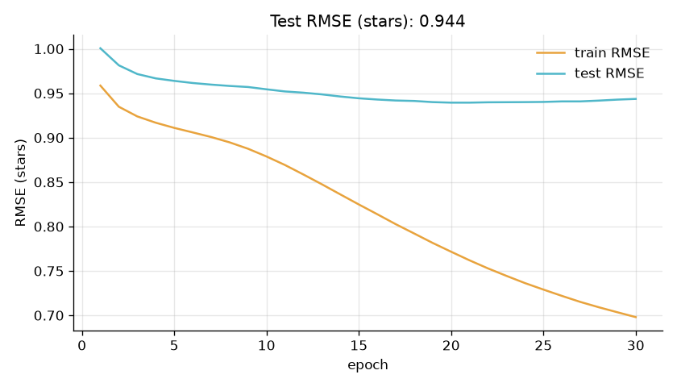

# Movie Recommendation System

**Recommendation · collaborative filtering.** Predicts how users would rate movies they haven't seen and recommends the best ones, using matrix factorisation trained with gradient descent.

Part of my ML portfolio, [LabOS](https://github.com/abdimajeet/labos-portfolio), where this project's training curve and results are shown in the Model Lab app.



## Results

| Metric | Value |
|---|---|
| Test RMSE (stars) | 0.944 |
| Best epoch | 20 (0.939) |
| Average-rating baseline | 1.122 |

## What I found

- The rating matrix is 93.7% empty: each user has rated only a tiny fraction of the movies, which is exactly what the model has to fill in.
- Popularity is uneven: the top 10% of movies receive 43% of all ratings. The average rating is 3.53 stars.
- Predicting every rating as the average gives an error of 1.122 stars. The model brings it down to 0.944.
- Test error is lowest at epoch 20 (0.939) and then creeps back up while train error keeps falling: the model starts memorising instead of learning. Stopping at epoch 20 would fix it.
- User 1's 5-star films include Toy Story (1995), Shanghai Triad (Yao a yao yao dao waipo qiao) (1995), Dead Man Walking (1995). The model's top picks for them: Close Shave, A (1995), Secrets & Lies (1996), City of Lost Children, The (1995), Paths of Glory (1957), Titanic (1997).

## How it works

- **Problem:** Predict how a user would rate movies they haven't seen, and recommend the highest-rated ones.
- **Dataset:** MovieLens 100K: 100,000 ratings (1–5 stars) from 943 users on 1,682 movies (Harper & Konstan, 2015). Uses the official `ua` split: 10 ratings per user held out for testing.
- **Preprocessing:** Turned user and movie ids into matrix indices; no other cleaning needed.
- **Exploration:** Measured how empty the rating matrix is, how ratings are spread across movies, and the average rating.
- **Model:** Matrix factorisation with user and movie biases (20 latent factors), trained with stochastic gradient descent and L2 regularisation, written in NumPy.
- **Evaluation:** RMSE in stars on the held-out ratings per epoch, compared with always predicting the average rating, plus example recommendations for one user.

| Setting | Value |
|---|---|
| model | Matrix factorisation, 20 latent factors |
| dataset | MovieLens 100K, 100k ratings |
| optimizer | SGD |
| lr | 0.01 |
| regularisation | 0.05 |
| split | official ua.base / ua.test |

## Run it

```bash
python -m venv .venv
.venv\Scripts\activate        # Windows; on macOS/Linux: source .venv/bin/activate
pip install -r requirements.txt
python movie_recommender.py
```

The first run downloads the dataset into `data/`. The script prints its progress and writes `results/movie-recommender.json` (scores, curve, findings) and `results/movie-recommender.png` (the chart above).

The MovieLens licence doesn't allow re-hosting the data, so it isn't in this repo; the script downloads it from GroupLens.

## Files

- `movie_recommender.py`: the whole project, top to bottom: load, explore, preprocess, train, evaluate.
- `common.py`: dataset download, rounding, and saving results and the chart.
- `results/`: output of the last run.

## License

Code: MIT. Datasets belong to their authors; see the dataset links in `common.py`.
